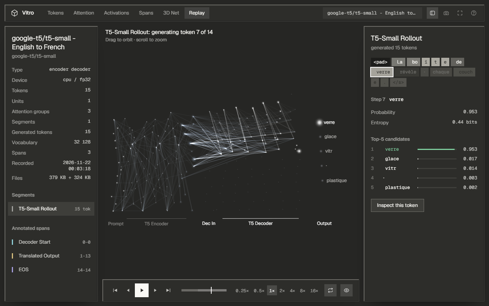
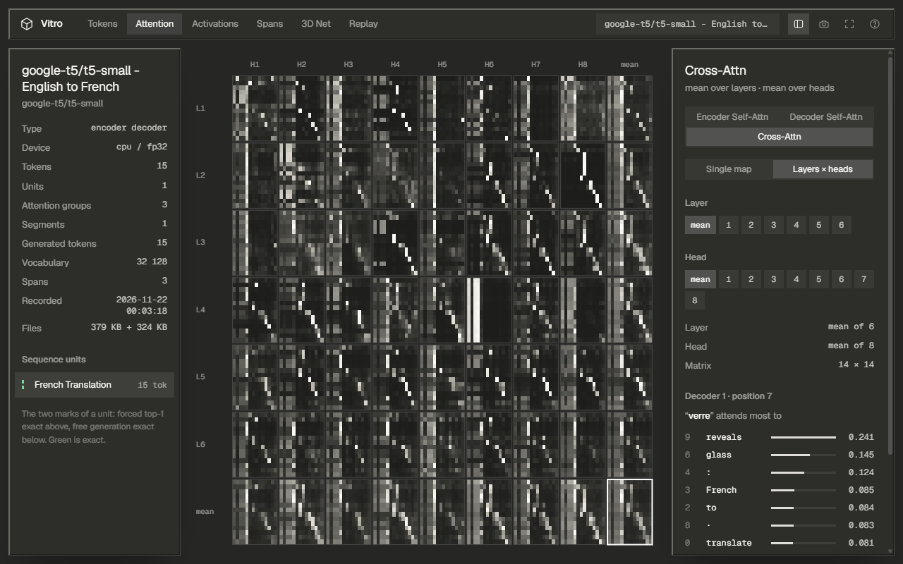
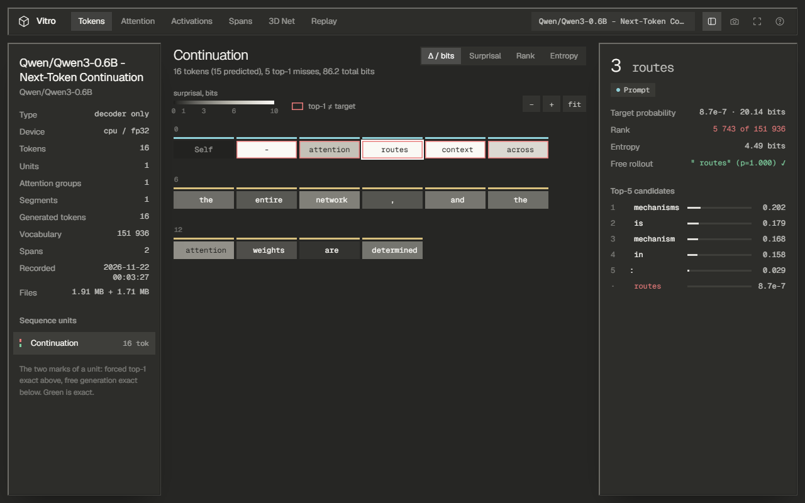

# Vitro

A glass-box inspector for PyTorch models. Vitro captures forward passes and autoregressive generation from PyTorch and HuggingFace transformers into compact binary files (.vtdump and .vtdemo), and opens them in **one app, `vitro.exe`**: tokens with their probabilities, attention, activations, labelled spans, a 3D view of the network with the path a prediction took, and a step-by-step 3D replay of a generation.

## The app

`vitro.exe` is a single Windows program of about 6 MB. Its interface is a web app (React, in `web/`) shown in the program's own window by the Microsoft Edge engine that Windows already has (WebView2). There is no server and no browser: the program carries the app, the sample traces and the licence notices inside itself, and the traces you open are read in the window and never uploaded.

    bin\vitro.exe                                          the start screen, with the sample traces
    bin\vitro.exe samples\t5_small.vtdump samples\t5_small.vtdemo   open the two files of one run

A dump (.vtdump) powers the inspector tabs and a recording (.vtdemo) the replay; open both files of one run to use every tab. Files can also be dropped on the window or on the program's icon, chosen with the picker (O), or listed on the command line. `vitro.exe --help` lists the options.

The six tabs (keys 1 to 6):

1. **Tokens**: the target sequence against the free rollout, user-labelled spans, surprisal, rank, entropy or numeric-error colours, and per-token top-K probabilities. Arrow keys step through tokens, E jumps to the next top-1 miss, D to the first divergence.
2. **Attention**: a heat map per layer and head with a switcher across all attention families of the model (encoder self, decoder self, cross-attention, ...), the mean over layers and heads, and a page of all layers by heads.
3. **Activations**: L2 activation norms across layers and sublayers, plus any 2D latent maps with their cosine similarity.
4. **Spans**: the labelled token intervals as a nested list, with the cost of each in bits and misses.
5. **3D Net**: the stage graph built from the trace, with a backward attention rollout from the selected token lighting the path that led to its prediction.
6. **Replay**: playback from reading the input context through each generated token at 0.25x to 16x speed, lighting the attention paths into each candidate. Space plays and pauses, the arrows step.

Press ? in the app for every key. S saves the picture of the open view as a PNG; the view you left is kept in the address of the window, so a view can be reproduced with `--hash`.

### Build

    bash build.sh app          builds bin/vitro.exe

You need MinGW-w64 g++ (MSYS2) and Python 3. The first build downloads the Microsoft WebView2 SDK, pinned to one version and checked against its SHA-256 (`tools/fetch_webview2.py`). The program is built from `web/dist`, which is committed, so Node is needed only to change the interface: `cd web && npm install && npm run build` renews `web/dist`, and `npm test` runs the interface tests.

### In a browser, on any system

    vitro web samples/t5_small.vtdump samples/t5_small.vtdemo

serves the same app on 127.0.0.1 (nothing leaves your machine) and opens it in your browser. This is the way to use Vitro on Linux and macOS.

## Included sample traces

Ready-to-open traces recorded from real pretrained text models live in samples/ (and are built into vitro.exe):

- samples/t5_small.vtdump and samples/t5_small.vtdemo: google-t5/t5-small translating "The glass box reveals every layer." into French (6 encoder layers, 6 decoder layers, cross-attention).
- samples/qwen3_0_6b.vtdump and samples/qwen3_0_6b.vtdemo: Qwen/Qwen3-0.6B autoregressive causal continuation (28 layers).

## Tracing a PyTorch model

Install the Python package in editable mode:

    pip install -e . --no-build-isolation

Minimal example with custom stage, span, and vocabulary labels:

    import torch
    from vitro import SpanLabel, TokenMeta, TraceSpec, auto_adapter, export_demo, export_dump

    spec = TraceSpec(
        trace_id="my_run",
        title="My Model Inspection",
        stage_labels={"input": "Prompt + Gen", "block_0": "Early Mixing"},
        group_labels={"decoder": "Blocks"},
        attn_names={"self": "Causal Self-Attn"},
        spans=[
            SpanLabel(0, 5, "Prompt", kind="prompt", tint="cyan"),
            SpanLabel(5, 12, "Output", kind="output", tint="gold", parent=0),
        ],
        token_meta=TokenMeta.from_tokenizer(tokenizer, vocab_size=model.config.vocab_size),
    )

    adapter = auto_adapter(model)
    demo = adapter.record_generation(prompt_ids, max_new_tokens=16, eos_id=tokenizer.eos_token_id, spec=spec)
    trace = adapter.trace_forward(torch.from_numpy(demo.ftok[None].astype("int64")), spec=spec)

    export_dump("my_trace.vtdump", trace, spec=spec, free_tokens=[demo.ftok], free_probs=[demo.fp])
    export_demo("my_trace.vtdemo", demo, spec=spec, vocab_size=model.config.vocab_size)

auto_adapter supports custom causal decoders (DecoderOnlyAdapter), nn.Transformer encoder-decoder models (EncoderDecoderAdapter), and HuggingFace CausalLM / Seq2Seq models offline (HuggingFaceAdapter, automatically switching subconfigs to eager attention so attention weights can be captured).

Runnable examples live in examples/: tiny_decoder_only.py, tiny_encoder_decoder.py, and hf_text_transformer.py (for local HuggingFace text models such as google-t5/t5-small and Qwen/Qwen3-0.6B).

CLI helpers:

    vitro app samples/t5_small.vtdump        open the app (bin/vitro.exe) with files
    vitro web samples/t5_small.vtdump        serve the app to your browser
    vitro info samples/t5_small.vtdump       print the summary of a trace file

The older programs `vitro_view.exe` (inspector) and `vitro_demo.exe` (player) are still built by `bash build.sh` and reachable as `vitro view` and `vitro demo`; `vitro.exe` replaces both.

## Repository layout

    python/vitro/       Python capture hooks, PyTorch & HuggingFace adapters, trace specs, binary container, CLI, web server
    web/                The interface: React and TypeScript sources (web/src), tests (web/tests), the built app (web/dist)
    cpp/src/app_*       vitro.exe: the window, the WebView2 host, the built-in resources and the library of traces
    cpp/include/vitro/  Reusable C++ headers (binary container reader, JSON parser, Win32 shell, GDI canvas, 3D helpers)
    cpp/src/view_*      The older vitro_view.exe and vitro_demo.exe
    tools/              Build helpers: the WebView2 SDK download, the resources of vitro.exe, the icon
    examples/           Causal, encoder-decoder, and HuggingFace text scripts
    samples/            Pre-recorded .vtdump and .vtdemo traces from real text models
    assets/             Screenshots used in README.md
    tests/              End-to-end verification suite

Third-party components inside vitro.exe (the WebView2 loader, the Geist typefaces, React) are listed with their licences in THIRD_PARTY_NOTICES.txt; `vitro.exe --licenses` prints them.

## Tests

Run all checks:

    python tests/run_all.py

They cover the container format (round trips and refusals), hook parity across causal, seq2seq, and HuggingFace models, the older programs (selftest, NumPy digest parity, PNG rendering, UI events, window loop), real sample traces, a leak audit, and for the app: the web server and its refusals, the interface's TypeScript tests (vitest), the browser reader against NumPy on every sample (numbers to 1e-9, every float16 pattern, the words of every refusal), the committed `web/dist` against a fresh build, and the real `vitro.exe` with its real window (command line, what the page can fetch, six views, replay, screenshot). The parts that need Node or Pillow say so when they are skipped.
