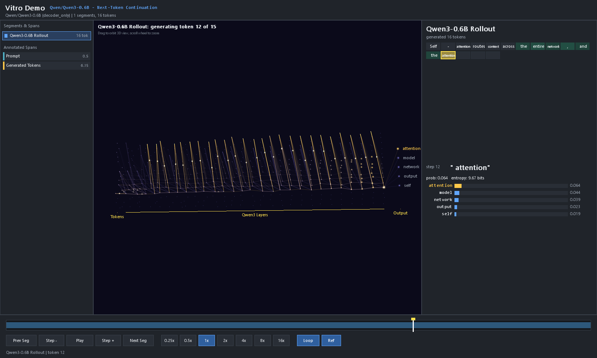
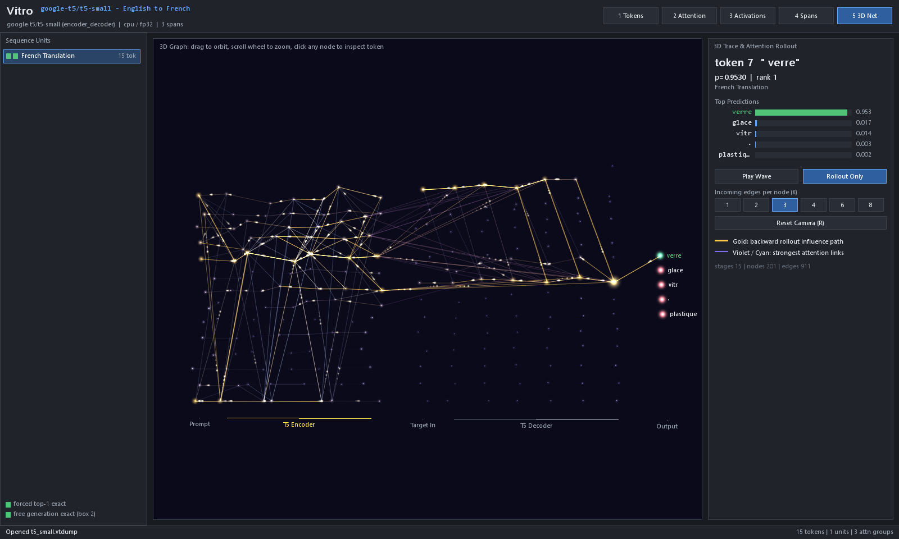

# Vitro

Visual trace inspector and 3D generation player for PyTorch models.

Vitro captures forward passes and autoregressive generation from PyTorch and HuggingFace transformers into compact binary files (.vtdump and .vtdemo), then renders them in two standalone Windows C++ programs (Win32 and GDI, static build, no Python or GPU needed to inspect saved traces).

## Included sample traces

Ready-to-open traces recorded from real pretrained text models live in samples/:

- samples/t5_small.vtdump and samples/t5_small.vtdemo: google-t5/t5-small translating "The glass box reveals every layer." into French (6 encoder layers, 6 decoder layers, cross-attention).
- samples/qwen3_0_6b.vtdump and samples/qwen3_0_6b.vtdemo: Qwen/Qwen3-0.6B autoregressive causal continuation (28 layers).

Open them directly after building:

    bin/vitro_view.exe samples/t5_small.vtdump
    bin/vitro_demo.exe samples/qwen3_0_6b.vtdemo

Qwen3-0.6B 28-layer step-by-step generation replay in vitro_demo.exe:

T5-small backward attention rollout (3D Net view) and 6x8 cross-attention grid in vitro_view.exe:

Qwen3-0.6B token surprisal strip, span annotations, and top-5 candidates (Tokens view):

## Viewer and player

Both programs are ordinary desktop windows. Press Ctrl+O or drag and drop a file onto the window to open it, B returns to the file list, Ctrl+wheel (or Ctrl with +, -, 0) scales the interface, F11 toggles full screen, S saves a PNG screenshot, and F1 prints the controls.

In vitro_view.exe, keys 1 through 5 switch views:

1. Tokens: target sequence against free rollout, user-labeled spans, surprisal/rank/entropy/scalar-delta colors, and per-token top-K probabilities (arrow keys step tokens, E jumps to errors, D jumps to divergence).
2. Attention: per-layer and head attention heatmaps with a switcher across all attention families in the model (encoder self, decoder self, cross-attention, etc.) plus a grid over all layers and heads.
3. Activations: L2 activation norms across layers and sublayers, plus any optional 2D latent maps and cosine similarity matrices.
4. Spans: hierarchical breakdown of labeled token intervals and per-span bit cost.
5. 3D Net: dynamic 3D stage graph built from the trace, backward attention rollout highlighting from the selected token, and animated activation pulses.

In vitro_demo.exe, playback runs from reading the input context through each autoregressive token step at 0.25x to 16x speed, lighting the active attention paths into each candidate token.

## Tracing a PyTorch model

Install the Python package in editable mode and build the C++ programs (MinGW-w64 g++ and zlib on Windows):

    bash build.sh
    pip install -e . --no-build-isolation

Minimal example with custom stage, span, and vocabulary labels:

    import torch
    from vitro import SpanLabel, TokenMeta, TraceSpec, auto_adapter, export_demo, export_dump

    spec = TraceSpec(
        trace_id="my_run",
        title="My Model Inspection",
        stage_labels={"input": "Prompt + Gen", "block_0": "Early Mixing"},
        group_labels={"decoder": "Blocks"},
        attn_names={"self": "Causal Self-Attn"},
        spans=[
            SpanLabel(0, 5, "Prompt", kind="prompt", tint="cyan"),
            SpanLabel(5, 12, "Output", kind="output", tint="gold", parent=0),
        ],
        token_meta=TokenMeta.from_tokenizer(tokenizer, vocab_size=model.config.vocab_size),
    )

    adapter = auto_adapter(model)
    demo = adapter.record_generation(prompt_ids, max_new_tokens=16, eos_id=tokenizer.eos_token_id, spec=spec)
    trace = adapter.trace_forward(torch.from_numpy(demo.ftok[None].astype("int64")), spec=spec)

    export_dump("my_trace.vtdump", trace, spec=spec, free_tokens=[demo.ftok], free_probs=[demo.fp])
    export_demo("my_trace.vtdemo", demo, spec=spec, vocab_size=model.config.vocab_size)

auto_adapter supports custom causal decoders (DecoderOnlyAdapter), nn.Transformer encoder-decoder models (EncoderDecoderAdapter), and HuggingFace CausalLM / Seq2Seq models offline (HuggingFaceAdapter, automatically switching subconfigs to eager attention so attention weights can be captured).

Runnable examples live in examples/: tiny_decoder_only.py, tiny_encoder_decoder.py, and hf_text_transformer.py (for local HuggingFace text models such as google-t5/t5-small and Qwen/Qwen3-0.6B).

CLI helpers:

    vitro info samples/t5_small.vtdump
    vitro view samples/t5_small.vtdump
    vitro demo samples/qwen3_0_6b.vtdemo
    vitro selftest

## Repository layout

    python/vitro/     Python capture hooks, PyTorch & HuggingFace adapters, trace specs, binary container, CLI
    cpp/include/vitro/ Reusable C++ headers (binary container reader, JSON parser, Win32 shell, GDI canvas, 3D helpers)
    cpp/src/          vitro_view.exe and vitro_demo.exe sources
    examples/         Causal, encoder-decoder, and HuggingFace text scripts
    samples/          Pre-recorded .vtdump and .vtdemo traces from real text models
    assets/           Screenshots used in README.md
    tests/            End-to-end verification suite

## Tests

Run all checks (container format roundtrips and refusals, hook parity across causal, seq2seq, and HuggingFace models, C++ selftest, NumPy digest parity, PNG rendering, UI events, Win32 window loop, real sample trace checks, and leak audit):

    python tests/run_all.py
