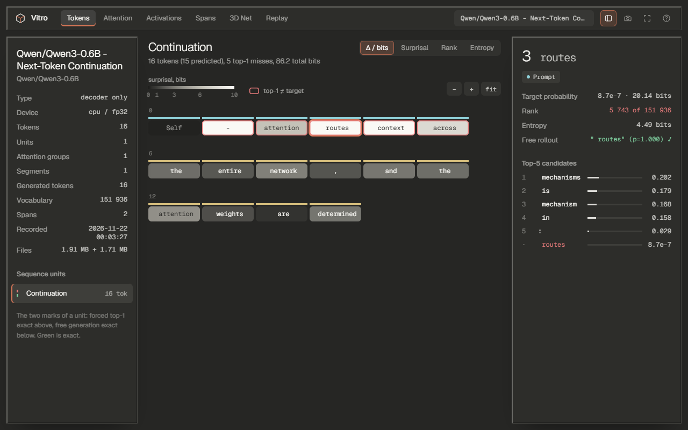
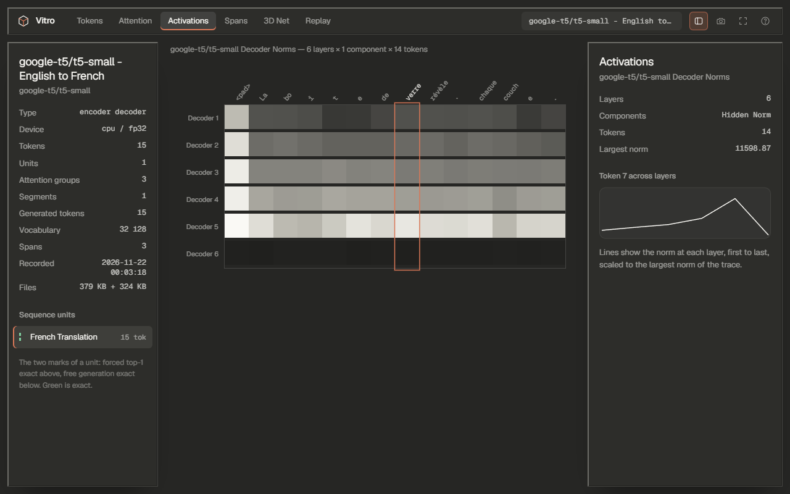
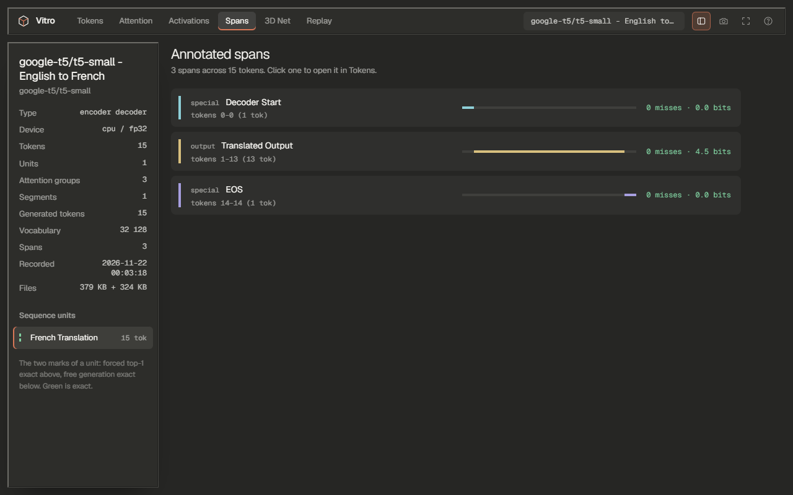
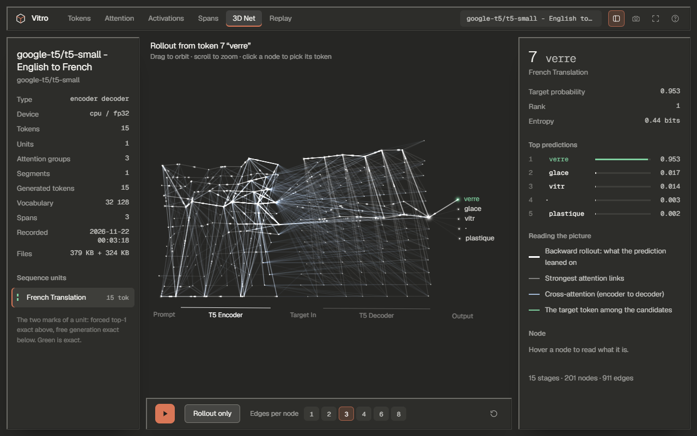
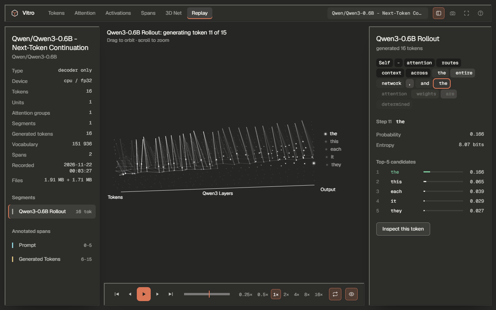
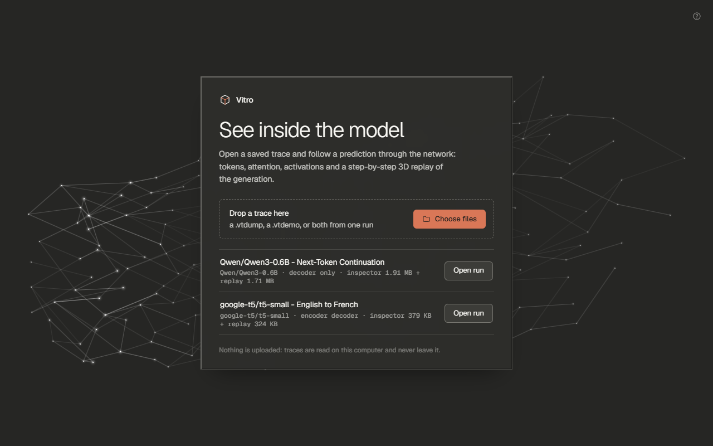

  

<h1 align="center">Vitro</h1>

  <b>A glass-box inspector for PyTorch models.</b> 
  Every token and its probability, every attention head, the activations, and the path a prediction took through the network, in one small Windows program or in your browser.

  <a href="https://eldroot-studios.github.io/vitro/"><b>Try it in your browser</b></a>
  &nbsp;·&nbsp;
  <a href="https://github.com/EldRoot-Studios/vitro/releases/latest/download/vitro.exe"><b>Download vitro.exe</b></a>
  &nbsp;·&nbsp;
  <a href="https://github.com/EldRoot-Studios/vitro/releases/latest">Release notes</a>
  &nbsp;·&nbsp;
  <a href="CHANGELOG.md">Changelog</a>

  
  
  
  

  

Vitro records a forward pass, or a whole autoregressive generation, of a PyTorch or HuggingFace transformers model into two compact binary files (`.vtdump` for the inspector, `.vtdemo` for the replay) and opens them in **one app**: tokens with their probabilities, attention, activations, labelled spans, a 3D view of the network with the path a prediction took, and a step-by-step 3D replay of a generation.

## Get Vitro

**In your browser, on any system.** Open the [browser demo](https://eldroot-studios.github.io/vitro/): the two sample runs are built in, and you can choose your own `.vtdump` and `.vtdemo` files on its start screen. They are read in the page and never uploaded. Some views to start from: [the replay of T5-small translating a sentence](https://eldroot-studios.github.io/vitro/#open=3,2&view=replay), [the 3D net with the path that led to the word "verre"](https://eldroot-studios.github.io/vitro/#open=3,2&view=net&token=7), [the attention of every layer and head](https://eldroot-studios.github.io/vitro/#open=3,2&view=attention&token=7&fam=2&grid=1) and [the tokens of a Qwen3-0.6B continuation](https://eldroot-studios.github.io/vitro/#open=1,0&view=tokens&token=3). The demo is built for a computer screen; on a phone the start screen works, but the views are cramped.

**Windows 10 and 11.** Download [`vitro.exe`](https://github.com/EldRoot-Studios/vitro/releases/latest/download/vitro.exe) from the latest release and double-click it. It is one file of about 6 MB: no installer, no server, no browser. The app, the sample traces and the licence notices are inside it, and the traces you open are read in the window and never uploaded. It needs the Microsoft Edge WebView2 Runtime, which comes with Windows 11 and current Windows 10. The program is not code-signed, so Windows SmartScreen may ask you to confirm the first start; the SHA-256 of every release file is in the release notes.

**Linux and macOS, on your own machine.** In a clone of this repository (after installing the package, see below), `vitro web` serves the same app on 127.0.0.1 and opens it in your browser; nothing leaves your machine.

    vitro web samples/t5_small.vtdump samples/t5_small.vtdemo

## A tour of the six tabs

<table>
  <tr>
    <td width="50%" valign="top">
      
       <b>1. Tokens</b> 
      The target sequence against the free rollout, with user-labelled spans, surprisal, rank, entropy or numeric-error colours, and the top-K probabilities of every token. The arrow keys step through the tokens, <kbd>E</kbd> jumps to the next top-1 miss, <kbd>D</kbd> to the first divergence.
    </td>
    <td width="50%" valign="top">
      
       <b>2. Attention</b> 
      A heat map per layer and head, a switcher across all attention families of the model (encoder self, decoder self, cross-attention, ...), the mean over layers and heads, and a page of all layers by heads.
    </td>
  </tr>
  <tr>
    <td width="50%" valign="top">
      
       <b>3. Activations</b> 
      L2 activation norms across layers and sublayers, and any 2D latent maps with their cosine similarity.
    </td>
    <td width="50%" valign="top">
      
       <b>4. Spans</b> 
      The labelled token intervals as a nested list, with the cost of each in bits and misses.
    </td>
  </tr>
  <tr>
    <td width="50%" valign="top">
      
       <b>5. 3D Net</b> 
      The stage graph built from the trace, with a backward attention rollout from the selected token lighting the path that led to its prediction.
    </td>
    <td width="50%" valign="top">
      
       <b>6. Replay</b> 
      Playback from reading the input context through each generated token at 0.25x to 16x speed, lighting the attention paths into each candidate. <kbd>Space</kbd> plays and pauses, the arrows step.
    </td>
  </tr>
</table>

## Open a trace

    vitro.exe                                                     the start screen, with the sample traces
    vitro.exe samples\t5_small.vtdump samples\t5_small.vtdemo     open the two files of one run

  

A dump (`.vtdump`) powers the inspector tabs and a recording (`.vtdemo`) the replay; open both files of one run to use every tab. Files can also be dropped on the window or on the program's icon, chosen with the picker (<kbd>O</kbd>), or listed on the command line. `vitro.exe --help` lists the options.

Keys <kbd>1</kbd> to <kbd>6</kbd> switch the tabs, <kbd>S</kbd> saves the open view as a PNG, and <kbd>?</kbd> shows every key. The view you left is kept in the address of the window, so a view can be reproduced with `--hash`, which is how the pictures above were made (`tools/make_screenshots.py`).

## Included sample traces

Ready-to-open traces recorded from real pretrained text models live in `samples/` (and are built into `vitro.exe`):

- `samples/t5_small.vtdump` and `samples/t5_small.vtdemo`: google-t5/t5-small translating "The glass box reveals every layer." into French (6 encoder layers, 6 decoder layers, cross-attention).
- `samples/qwen3_0_6b.vtdump` and `samples/qwen3_0_6b.vtdemo`: Qwen/Qwen3-0.6B autoregressive causal continuation (28 layers).

## Tracing a PyTorch model

Install the Python package from a clone, in editable mode (or use the wheel attached to a release):

    pip install -e . --no-build-isolation

Minimal example with custom stage, span, and vocabulary labels:

    import torch
    from vitro import SpanLabel, TokenMeta, TraceSpec, auto_adapter, export_demo, export_dump

    spec = TraceSpec(
        trace_id="my_run",
        title="My Model Inspection",
        stage_labels={"input": "Prompt + Gen", "block_0": "Early Mixing"},
        group_labels={"decoder": "Blocks"},
        attn_names={"self": "Causal Self-Attn"},
        spans=[
            SpanLabel(0, 5, "Prompt", kind="prompt", tint="cyan"),
            SpanLabel(5, 12, "Output", kind="output", tint="gold", parent=0),
        ],
        token_meta=TokenMeta.from_tokenizer(tokenizer, vocab_size=model.config.vocab_size),
    )

    adapter = auto_adapter(model)
    demo = adapter.record_generation(prompt_ids, max_new_tokens=16, eos_id=tokenizer.eos_token_id, spec=spec)
    trace = adapter.trace_forward(torch.from_numpy(demo.ftok[None].astype("int64")), spec=spec)

    export_dump("my_trace.vtdump", trace, spec=spec, free_tokens=[demo.ftok], free_probs=[demo.fp])
    export_demo("my_trace.vtdemo", demo, spec=spec, vocab_size=model.config.vocab_size)

`auto_adapter` supports custom causal decoders (`DecoderOnlyAdapter`), `nn.Transformer` encoder-decoder models (`EncoderDecoderAdapter`), and HuggingFace CausalLM / Seq2Seq models offline (`HuggingFaceAdapter`, automatically switching subconfigs to eager attention so attention weights can be captured).

Runnable examples live in `examples/`: `tiny_decoder_only.py`, `tiny_encoder_decoder.py`, and `hf_text_transformer.py` (for local HuggingFace text models such as google-t5/t5-small and Qwen/Qwen3-0.6B).

CLI helpers:

    vitro app samples/t5_small.vtdump        open the app (bin/vitro.exe) with files
    vitro web samples/t5_small.vtdump        serve the app to your browser
    vitro info samples/t5_small.vtdump       print the summary of a trace file

The older programs `vitro_view.exe` (inspector) and `vitro_demo.exe` (player) are still built by `bash build.sh` and reachable as `vitro view` and `vitro demo`; `vitro.exe` replaces both.

## Build from source

    bash build.sh app          builds bin/vitro.exe

You need MinGW-w64 g++ (MSYS2) and Python 3. The first build downloads the Microsoft WebView2 SDK, pinned to one version and checked against its SHA-256 (`tools/fetch_webview2.py`). The program is built from `web/dist`, which is committed, so Node is needed only to change the interface: `cd web && npm install && npm run build` renews `web/dist`, and `npm test` runs the interface tests. How the program is put together: its interface is a web app (React, in `web/`) shown in the program's own window by the Microsoft Edge engine that Windows already has (WebView2); a small C++ host answers the page's requests itself (the library of traces, the trace files, the app's files), so there is no server.

The browser demo is made from `web/dist`, `samples/` and `assets/social.png` by `python tools/make_demo_site.py --out _site`. The workflow `.github/workflows/demo.yml` checks that builder and publishes the result to GitHub Pages on every change to those files.

## Troubleshooting

**`cannot write ...\AppData\Local\Vitro\...`** The program unpacks a small helper library and keeps the window engine's profile (about 20 MB) in `%LOCALAPPDATA%\Vitro`. If that disk is full or the folder is read-only, free some space, or point Vitro at a folder on another disk with `VITRO_DATA_DIR`:

    set VITRO_DATA_DIR=D:\VitroData
    vitro.exe

In PowerShell, set it with `$env:VITRO_DATA_DIR = 'D:\VitroData'` instead.

**The window does not open.** Check that the Microsoft Edge WebView2 Runtime is installed. It comes with Windows 11 and current Windows 10; on an older system, install the Evergreen runtime from Microsoft.

**"Windows protected your PC".** `vitro.exe` is not code-signed. Choose *More info*, then *Run anyway*, or compare the SHA-256 of the file with the one in the release notes first.

## Repository layout

    python/vitro/       Python capture hooks, PyTorch & HuggingFace adapters, trace specs, binary container, CLI, web server
    web/                The interface: React and TypeScript sources (web/src), tests (web/tests), the built app (web/dist)
    cpp/src/app_*       vitro.exe: the window, the WebView2 host, the built-in resources and the library of traces
    cpp/include/vitro/  Reusable C++ headers (binary container reader, JSON parser, Win32 shell, GDI canvas, 3D helpers)
    cpp/src/view_*      The older vitro_view.exe and vitro_demo.exe
    tools/              Build helpers: the WebView2 SDK download, the resources of vitro.exe, the icon, the README pictures, the browser demo's builder
    .github/workflows/  The workflow that publishes the browser demo to GitHub Pages
    examples/           Causal, encoder-decoder, and HuggingFace text scripts
    samples/            Pre-recorded .vtdump and .vtdemo traces from real text models
    assets/             Pictures used in README.md and in link previews, made by tools/make_screenshots.py
    tests/              End-to-end verification suite
    CHANGELOG.md        What changed in each release

## Tests

Run all checks:

    python tests/run_all.py

They cover the container format (round trips and refusals), hook parity across causal, seq2seq, and HuggingFace models, the older programs (selftest, NumPy digest parity, PNG rendering, UI events, window loop), real sample traces, a leak audit, release hygiene (one version in every file that states it, and a changelog entry for it), the builder of the browser demo (the site it writes against the app and the samples, and its refusals), and for the app: the web server and its refusals, the interface's TypeScript tests (vitest), the browser reader against NumPy on every sample (numbers to 1e-9, every float16 pattern, the words of every refusal), the committed `web/dist` against a fresh build, and the real `vitro.exe` with its real window (command line, what the page can fetch, six views, replay, screenshot). The parts that need Node or Pillow say so when they are skipped.

## Licence

MIT, see [LICENSE](LICENSE). Third-party components inside `vitro.exe` (the WebView2 loader, the Geist typefaces, React) are listed with their licences in [THIRD_PARTY_NOTICES.txt](THIRD_PARTY_NOTICES.txt); `vitro.exe --licenses` prints them.
